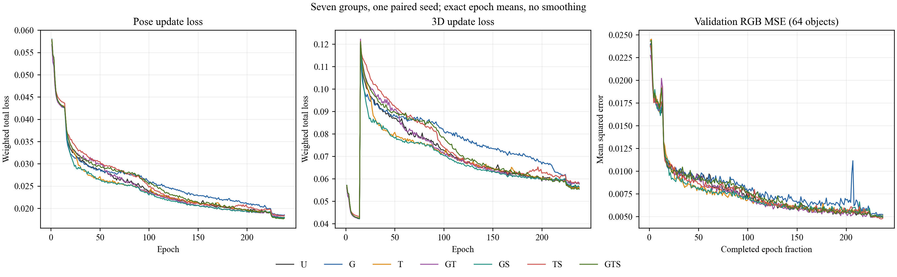

# U-OPT

Single-view mesh reconstruction built on [UNICORN](https://github.com/monniert/unicorn).
This release includes the model, seven controlled chair ablations, checkpoint
and resume logic, real loss logging, geometry/image evaluation and audited results.

[中文说明](docs/README_zh.md) · [Reproduction](docs/REPRODUCING.md) ·
[Evaluation protocol](docs/EVALUATION.md) · [Results](docs/RESULTS.md)

## Components

- **G:** geometry residual MLP; **T:** texture residual MLP;
  **S:** delayed linear residual-fusion schedule.
- Seven groups: **U, G, T, GT, GS, TS, GTS**. S alone has no residual branch
  to schedule and is identical to U.
- Paired initialization, alpha buffers, separate optimizer groups, gradient
  clipping/isolation, complete restart state and a real-GPU smoke gate.
- Per-update weighted losses, validation, PNG/PDF curves, final-checkpoint
  evaluation, per-object caches and explicit metric definitions.

Alternating pose/3D updates, progressive conditioning, template topology,
neighbor consistency and rendering are inherited from UNICORN. They are not
introduced as new U-OPT components. See [attribution](NOTICE.md).

## Install

Linux/CUDA is required for training/evaluation; Slurm is supported.
Original experiments: Python3.9, PyTorch1.13.1+CUDA11.6,
torchvision0.14.1, PyTorch3D0.7.2, A10040GB.

```bash
conda env create -f environment.yml
conda activate uopt
```

The environment file targets that runtime; solving/installing it is
machine-dependent. If PyTorch3D must be built, use matching **v0.7.2** source and
compatible CUDA/compiler versions. Run the provided GPU smoke on each new
environment. Bitwise-identical CUDA training trajectories are not claimed.

## Data and offline VGG

Obtain ShapeNet NMR using the [upstream data instructions](https://github.com/monniert/unicorn#2-download-datasets-arrow_down)
and comply with the dataset terms. Images, annotations and point clouds are not
redistributed here. The chair category layout is:

```text
/path/to/03001627/
  softras_train.lst
  softras_val.lst
  softras_test.lst
  OBJECT_ID/
    image/0000.png ... image/0023.png
    cameras.npz
    pointcloud.npz
```

Provide the full torchvision
[`vgg16-397923af.pth`](https://download.pytorch.org/models/vgg16-397923af.pth)
file locally, SHA256:
`397923af8e79cdbb6a7127f12361acd7a2f83e06b05044ddf496e83de57a5bf0`.
The launcher sets `UOPT_VGG_WEIGHTS` from your argument. No downloads occur
during training.

## Train the seven ablations

Replace example paths; keep the dataset and writable workspace separate.

```bash
python train.py --prepare --workspace /path/to/uopt-workspace \
  --data-root /path/to/03001627 \
  --vgg-weights /path/to/vgg16-397923af.pth
sbatch /path/to/uopt-workspace/stages/chair_ablation_v1/smoke.sbatch
```

After the smoke report says `ALL_PASSED: True`:

```bash
sbatch /path/to/uopt-workspace/stages/chair_ablation_v1/train_array.sbatch
```

At most **two single-GPU jobs** run together. Each group trains238 epochs,
batch32,846804 updates. Preparation freezes source/config hashes and refuses
to overwrite a stage. See [resume/local GPU instructions](docs/REPRODUCING.md).

## Evaluate final weights

After all seven final checkpoints exist:

```bash
python evaluate.py --prepare --workspace /path/to/uopt-workspace
sbatch /path/to/uopt-workspace/stages/chair_metrics_v1/pilot.sbatch
```

After the7×8-object pilot passes:

```bash
sbatch /path/to/uopt-workspace/stages/chair_metrics_v1/evaluate_array.sbatch
python scripts/summarize_results.py \
  --stage /path/to/uopt-workspace/stages/chair_metrics_v1 \
  --output /path/to/summary
```

All1356 chair test objects, input view0,10000 prediction/GT points. Metrics:
CD, F-score, normal consistency, triangle quality, RGB MSE, PSNR, SSIM.
Read the [protocol](docs/EVALUATION.md): geometry uses GT-assisted alignment
and ICP with anisotropic scaling.

## Audited results

One seed132422, fixed epoch238. Geometry columns are **after ICP**;
image metrics use the predicted input camera before ICP.

| Group | CD-L1×10 ↓ | F@1% ↑ | F@2% ↑ | Normal ↑ | PSNR/dB ↑ | SSIM ↑ |
|---|---:|---:|---:|---:|---:|---:|
| U | 0.281332 | 34.656% | 65.333% | 0.718038 | 24.797 | 0.836942 |
| G | 0.291119 | 33.419% | 63.528% | 0.711774 | 24.674 | 0.834396 |
| T | 0.279187 | 34.735% | 65.538% | 0.719612 | 24.880 | 0.838837 |
| GT | 0.285280 | 33.764% | 64.467% | 0.712763 | 24.646 | 0.834315 |
| GS | **0.271437** | **35.579%** | **66.772%** | **0.720157** | 24.722 | 0.836355 |
| TS | 0.286399 | 33.902% | 64.191% | 0.717878 | 24.766 | 0.836135 |
| GTS | 0.280643 | 34.472% | 65.246% | 0.716118 | **25.016** | **0.841768** |

GTS has the best image means. Its CD is only0.245% lower than U;
F-scores and normal consistency are slightly worse. GS has the best post-ICP
geometry means. These single-seed results do **not** show every component or
metric improves. [Detailed results](docs/RESULTS.md) include unrounded data.



## Weights and verification

Task checkpoints are **not included**; no public checkpoint download is currently
provided. Train from scratch using this recipe. Legacy `model.pkl` files are
not interchangeable with the `uopt_ablation_v1` final checkpoints. Relocating
an old private workspace does not create a matching public stage fingerprint.

Numerical model/optimizer and metric functions come from GPU-validated runs.
Public path/launch adapters have local preparation/CPU tests; they have not
undergone another complete seven-group GPU training. Run smoke/pilot on your
installation. This release covers the chair ablations, not every historical
manuscript experiment.

## License and citation

MIT; original UNICORN notices retained in [LICENSE](LICENSE) and
[licenses/UNICORN-MIT.txt](licenses/UNICORN-MIT.txt). Dependencies/datasets retain
their own terms. Please cite the upstream method:

```bibtex
@inproceedings{monnier2022unicorn,
  title={Share With Thy Neighbors: Single-View Reconstruction by Cross-Instance Consistency},
  author={Monnier, Tom and Fisher, Matthew and Efros, Alexei A. and Aubry, Mathieu},
  booktitle={ECCV},
  year={2022}
}
```

U-OPT publication metadata is not asserted here; reference this repository URL
and commit for the code release.
