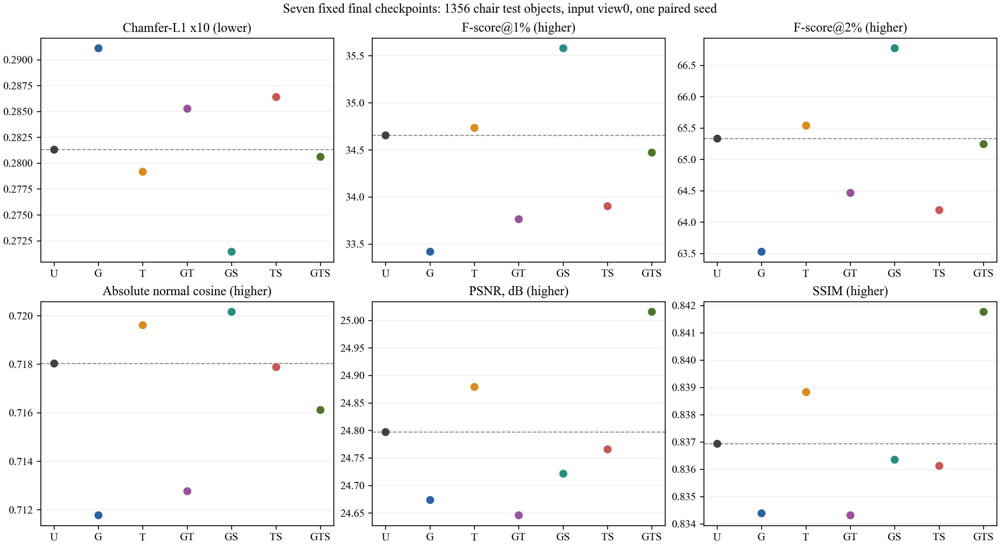
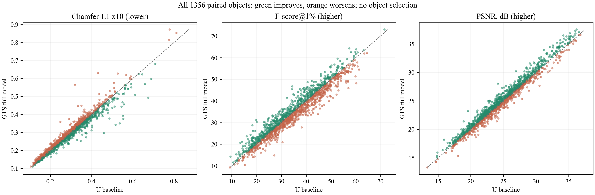

# Audited chair results

Use the root README table or the unrounded`results/chair/seven_group_metrics_unrounded.csv`.
All1356 objects/view0,seed132422,fixed final epoch238,paired training budgets.
Geometry is reported before and after ICP separately in the CSV.

## Interpretation

- GTS has the best PSNR/SSIM means:25.015589dB/.841768,compared with
  U24.797472dB/.836942. Its RGB MSE is3.505% lower.
- GTS post-ICP CD-L1×10 decreases only0.245%,.281332→.280643.
  F@1% changes-.184 percentage points,F@2%-.087pp,normal cosine-.001921.
  CD improves for604 objects,worsens for752;the median paired CD difference
  is+.001738. A small mean decrease is not a majority-object improvement.
- GTS PSNR improves on848/worsens on508 objects;SSIM improves on850/worsens
  on506. These are descriptive counts,not independent training replications.
- GS has best post-ICP geometry means:CD.271437,F@1%35.579%,F@2%66.772%,
  normal.720157. CD is3.517% lower than U. Average triangle quality decreases.
- T alone gives small post-ICP geometry/image improvements. G alone worsens
  post-ICP CD/F-scores/normals and image means relative to U.
- TS has the highest mean triangle quality. Before ICP,TS also has best CD
  and F-scores;alignment choices change ranking. Do not switch protocol per model.
- S improves the post-ICP geometry/image means of G→GS and GT→GTS,but the
  corresponding T→TS comparison worsens. It is not a universal improvement.

| Group | Mean triangle quality ↑ |
|---|---:|
| U | .527949 |
| G | .547885 |
| T | .535247 |
| GT | .543654 |
| GS | .509317 |
| TS | **.589038** |
| GTS | .534440 |

These are single-seed results. No statistical significance,multi-category
generalization,self-intersection elimination or universal component gain is
claimed. No LPIPS or self-intersection score was computed. Historical saved
weights and other manuscript tables are not mixed into this result table.

## Evidence and data files

-`all_9492_objects.csv`:all per-object entries,no selected subset.
-`seven_group_metrics_unrounded.csv`:means before display rounding.
-`all_pairwise_effects.csv`:paired differences,object counts and mean changes.
-`seven_epoch_phase_means.csv`:exact means of all updates/epoch/phase.
-`seven_validation_records.csv`:211 monitoring points/group,64 held-out objects.
-`provenance.json`:upstream/source hashes and release boundaries.

Original training evidence:5927628 updates,1477 validation entries.
Final test evidence:9492 entries from9436 full-stage new rows and56 reused
pilot entries. JSON/CSV/object-cache data agreed field-for-field;means,F-score
and PSNR/MSE relationships were independently recomputed. Model restoration
checks were exact,including final alpha,and repeated mesh/pose differences0.
No GT test objects overlapped training or monitored validation objects.

No negative ICP scales or PSNR120dB cap events occurred. Some residual texture
outputs exceed[0,1];clipping is explicit and recorded,not hidden or model-specific.
Fixed topology has642 vertices/1280 faces/1920 edges for all groups;connectivity
alone says nothing about shape fidelity or self-intersections.

## Regenerate figures from numerical data

```bash
python scripts/plot_results.py --output /path/to/figures
```

Training curves use exact epoch/phase arithmetic means without smoothing.
Individual updates were not fabricated from final checkpoints. The original
large per-update CSV files,private cluster paths,and raw dataset images are not
redistributed in Git.




